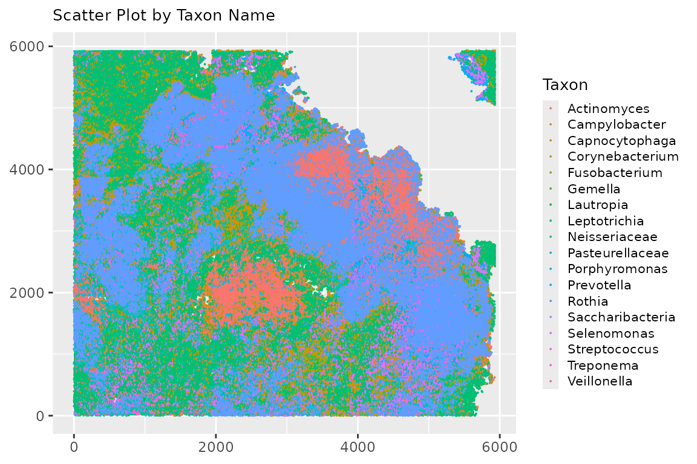
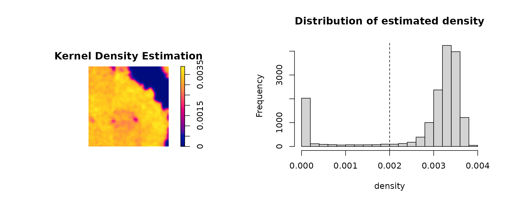
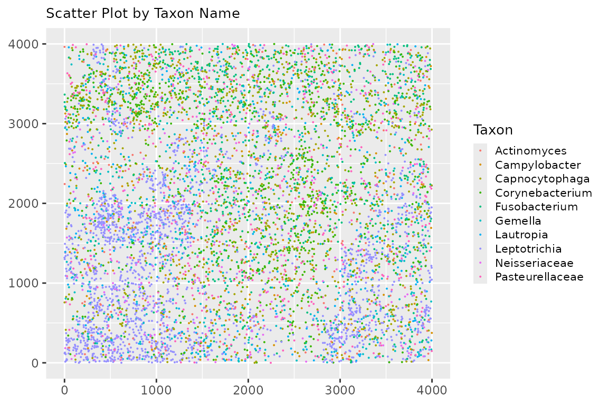
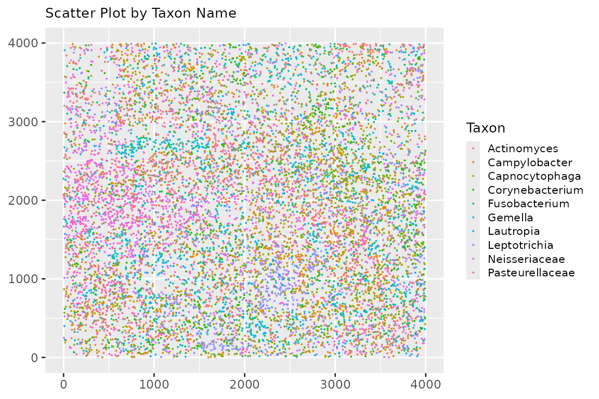
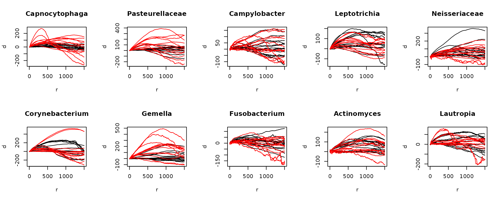

# MiSA Vignette

## Overview

MiSA identifies disease-associated spatial dysbiosis by testing whether
the spatial organization of microbial taxa differs between clinical
groups, using image-based microbiome data. A typical analysis follows
these steps:

1.  **Preprocessing:** identify the region of study (i.e., the area
    colonized by microbes) in each image and build observation windows
    ([`kde_est()`](https://liuruoqian.github.io/MiSA/reference/kde_est.md),
    [`alpha_windows()`](https://liuruoqian.github.io/MiSA/reference/alpha_windows.md)).
2.  **Taxon-level testing:** characterize the spatial distribution of
    each taxon with the summary function *d(r)* and compare it between
    groups using the four MiSA variants.
3.  **Community-level testing:** combine the taxon-level results to
    assess overall spatial dysbiosis.

Step 1 is described in the *Preprocessing* section, and steps 2 and 3 in
*MiSA test* section.

Step 1 is optional. Users who already have observation windows for their
images can pass them directly to
[`estimate_L()`](https://liuruoqian.github.io/MiSA/reference/estimate_L.md)
when running MiSA. If step 1 is skipped entirely,
[`estimate_L()`](https://liuruoqian.github.io/MiSA/reference/estimate_L.md)
uses a default window: the convex hull of the cell locations.

The following packages are required for functions and examples in the
MiSA package: ggplot2, grid, harmonicmeanp, spatstat.explore,
spatstat.geom, stats, deldir, sf.

``` r

library(MiSA)
```

## Preprocessing

In this step, we determine the true region of study (i.e., the area
colonized by microbes) in each image. We first estimate the density of
cells across the image, then build observation windows around the
high-density regions.

### Visialuze the example data

The example image is stored as a data frame with columns `x` and `y`
(the spatial coordinates of each cell) and `taxon_name` (the taxon
identity of each cell).

``` r

data(example_image)
plot_centroid(example_image)
```



### Kernel density estimate of cell locations

``` r

img_kde <- kde_est(example_image)

# visualize the distribution of density
par(mfrow=c(1,2))
plot(img_kde, main="Kernel Density Estimation")
hist(img_kde$v, main = "Distribution of estimated density", xlab = "density")
abline(v=0.002, lty=2)
```



### Determine region of study

[`alpha_windows()`](https://liuruoqian.github.io/MiSA/reference/alpha_windows.md)
builds observation windows around the high-density cell regions in each
image. Separated regions are kept apart, and each is returned as its own
`owin` object, sorted by area from largest to smallest.

`alpha` controls how tightly the window follows the shape of the
high-density region, in the same units as the coordinates. Smaller
values give a tighter, more detailed boundary, and larger values give a
smoother one. The default is 200.

We set `cutoff = 0.002` based on the histogram of estimated densities.
Areas with a kernel density below 0.002 are excluded from further
analysis.

With `fill_holes = TRUE`, holes within each region are filled, so each
window is bounded by its outer boundary only.

``` r

wins <- alpha_windows(img_kde, alpha = 200, cutoff = 0.002, fill_holes = TRUE)
#>          region region_area
#> region1 region1    28766056
#> region2 region2      193402
```

[`plot_regions()`](https://liuruoqian.github.io/MiSA/reference/plot_regions.md)
draws all observation window regions on a single plot, labeled by name.
It also returns the union of all regions as a single window (an owin
object), which we save as `W_all`.

Because each separated region is returned as its own window, users can
use a single region or combine several (e.g.,
`W <- spatstat.geom::union.owin(wins$region1, wins$region2)`) as the
true region of study.

In this example, we use `region1`, the largest region, as the region of
study and plot it over the example image.

``` r

par(mfrow=c(1,2))
W_all <- plot_regions(wins)

W <- wins$region1
plot(example_image$x, example_image$y, pch=20, col="pink", cex=0.1, main = "Microbial map with study region (W)", xlab = "", ylab = "")
plot(W, add = TRUE, lwd = 2)
```


When running MiSA, `W` can be used as the window for this image by
including it in the `groupA_window_list` or `groupB_window_list`
argument of
[`estimate_L()`](https://liuruoqian.github.io/MiSA/reference/estimate_L.md).
These arguments take a named list with one entry per image, where the
names match the image IDs,
e.g. `groupA_window_list <- list("image1" = W, "image2" = NULL, "image3" = NULL, ...)`.
Images set to `NULL` use the default window (the convex hull of the cell
locations).

## MiSA test

### Sample Data

We demonstrate MiSA using the sample data included in the package, which
were simulated based on real oral biofilm data. We need image-based
spatial microbiome data for both the health and disease groups, each
provided as a named list of data frames, with each data frame
representing one image. Ensure every image in the list has a name
assigned to it.

``` r

data(diseaseImg.list)             
data(healthImg.list)

names(healthImg.list)
#>  [1] "image1"  "image2"  "image3"  "image4"  "image5"  "image6"  "image7" 
#>  [8] "image8"  "image9"  "image10" "image11" "image12" "image13" "image14"
```

Each image data frame must contain columns named “x”, “y”, and
“taxon_name”, representing the x and y spatial coordinates and the
corresponding taxon identity. We then visualize two images from the
sample data, one from the health group and one from the disease group,
by plotting the centroid of each microbial cell.

``` r

str(healthImg.list[['image1']])
#> 'data.frame':    7349 obs. of  3 variables:
#>  $ x         : num  2233 2055 133 735 3835 ...
#>  $ y         : num  3520 1149 1412 2276 590 ...
#>  $ taxon_name: chr  "Capnocytophaga" "Pasteurellaceae" "Pasteurellaceae" "Campylobacter" ...
str(diseaseImg.list[['image1']])
#> 'data.frame':    10491 obs. of  3 variables:
#>  $ x         : num  1059 1870 3061 1607 1557 ...
#>  $ y         : num  3491 1239 2342 750 456 ...
#>  $ taxon_name: chr  "Neisseriaceae" "Fusobacterium" "Leptotrichia" "Fusobacterium" ...

plot_centroid(healthImg.list[['image1']])
```



``` r

plot_centroid(diseaseImg.list[['image1']])
```



### Estimate Spatial Summary Function

#### Estimate L Curves

To estimate the $`L`$ curves, we first pass the two lists containing our
sample data, `healthImg.list` and `diseaseImg.list` to
`groupA_image_list` and `groupB_image_list`, respectively.

A sequence of radii, `r_all`, must be pre-specified, over which the
$`L`$ function will be evaluated. This set of radii will be used
consistently across all images and must be carefully determined based on
the spatial range of images. In this example, we pre-specified the
sequence of radii as $`r=0, 6, 12, \dots, 1500`$, with a step size of 6.
The maximum radius, `rmax`, was set to 1500, which is
$`0.375 \times 4000`$, with 4000 being the side length of the square
image. In general, it is recommended to set the maximum $`r`$ no larger
than 0.5 times the length of the shortest side of the enclosing study
region, to account for the border effect.

`taxa_all` contains all taxa of interest.

Users can provide a pre-defined study region for the images in `groupA`
or `groupB` by passing input to `groupA_window_list` or
`groupB_window_list`. The input should be a named list for the
corresponding group, with each element being an object of class `owin`
(short for “observation window”), as required by the `window` argument
of
[`spatstat.geom::ppp()`](https://rdrr.io/pkg/spatstat.geom/man/ppp.html).
If a window is provided, its name must match the corresponding image’s
name in `groupA_image_list` or `groupB_image_list`. Users can specify a
window (study region) for some images and leave others as `NULL`. If
`NULL` is provided (either for a single image or the entire list), the
function will go with the default setting and derive a convex hull from
the data.

`border_correct` can be chosen from `"border"`, `"iso"`, and `"trans"`.
For spatial microbiome data, it is always recommended to select
`"border"`, as the other two options will substantially increase
computation time.

``` r

rmax  = 1500
r_all <- seq(0, rmax, length.out = 251) 
taxa_all <- unique(healthImg.list[[1]]$taxon_name)

L_result <- estimate_L(groupA_image_list=healthImg.list, groupB_image_list=diseaseImg.list, 
                    taxa=taxa_all, r_vec=r_all,
                    groupA_window_list = NULL, groupB_window_list = NULL,
                    border_correct = "border")
#> Estimating L for Group A, image1 - using default window (convex hull).
#> Estimating L for Group A, image2 - using default window (convex hull).
#> Estimating L for Group A, image3 - using default window (convex hull).
#> Estimating L for Group A, image4 - using default window (convex hull).
#> Estimating L for Group A, image5 - using default window (convex hull).
#> Estimating L for Group A, image6 - using default window (convex hull).
#> Estimating L for Group A, image7 - using default window (convex hull).
#> Estimating L for Group A, image8 - using default window (convex hull).
#> Estimating L for Group A, image9 - using default window (convex hull).
#> Estimating L for Group A, image10 - using default window (convex hull).
#> Estimating L for Group A, image11 - using default window (convex hull).
#> Estimating L for Group A, image12 - using default window (convex hull).
#> Estimating L for Group A, image13 - using default window (convex hull).
#> Estimating L for Group A, image14 - using default window (convex hull).
#> Estimating L for Group B, image1 - using default window (convex hull).
#> Estimating L for Group B, image2 - using default window (convex hull).
#> Estimating L for Group B, image3 - using default window (convex hull).
#> Estimating L for Group B, image4 - using default window (convex hull).
#> Estimating L for Group B, image5 - using default window (convex hull).
#> Estimating L for Group B, image6 - using default window (convex hull).
#> Estimating L for Group B, image7 - using default window (convex hull).
#> Estimating L for Group B, image8 - using default window (convex hull).
#> Estimating L for Group B, image9 - using default window (convex hull).
#> Estimating L for Group B, image10 - using default window (convex hull).
#> Estimating L for Group B, image11 - using default window (convex hull).
#> Estimating L for Group B, image12 - using default window (convex hull).
#> Estimating L for Group B, image13 - using default window (convex hull).
```

#### Estimate d Curves

`estimate_d` takes the estimated $`L`$ curves for `groupA` and `groupB`
as input, and outputs the estimated $`d`$ curve and the group label
(`groupA` or `groupB`) for each image.

``` r

d_result <- estimate_d(groupA_L = L_result$groupA_L, groupB_L = L_result$groupB_L, taxa = taxa_all,r_vec = r_all)
#> calculating d for Capnocytophaga 
#> calculating d for Pasteurellaceae 
#> calculating d for Campylobacter 
#> calculating d for Leptotrichia 
#> calculating d for Neisseriaceae 
#> calculating d for Corynebacterium 
#> calculating d for Gemella 
#> calculating d for Fusobacterium 
#> calculating d for Actinomyces 
#> calculating d for Lautropia
```

Visualize $`d`$ curves for each individual taxon, colored by groups.

``` r

par(mfrow=c(2,5))
for (taxon in taxa_all){
  d.mat <- d_result[[taxon]]
  r <- as.numeric(colnames(d.mat$d))
  matplot(r, t(d.mat$d), type = "l", lty = 1, col = ifelse(d.mat$group =="groupB", "red","black"), main=taxon, ylab = "d", xlab="r")
}
```



### Data Preparation for MiSA Test

The `MiSA_data` function prepares $`d`$ curves for MiSA test. Within
each taxon, it first filters out images with limited spatial range,
i.e., images whose $`d`$ curve does not have valid values up to a radius
threshold, `r_thresh`. By default (`r_thresh = NULL`), $`d`$ curves that
do not reach $`0.5 \times`$`max(r_all)` will be excluded. Users may set
`r_thresh` based on the scientific question of interest; for example,
`r_thresh = 500` will exclude $`d`$ curves that do not have valid
estimates up to $`r=500`$. For the curves that are kept, the function
truncates the estimated $`d`$ curves to the maximum $`r`$ shared in
common across all images (in both groups) for that taxon.

``` r

data_pre <- MiSA_data(est_d = d_result, r_thresh = NULL)
```

`MiSA_check` drops taxa that are not valid for hypothesis testing via
MiSA, based on the following criteria:

1.  Only one group remains after filtering.

2.  The total sample size is $`\leq 2`$.

3.  $`d`$ has one or fewer valid estimates.

``` r

data_checked <- MiSA_check(data_list = data_pre)
```

Use the following code to visualize the $`d`$ curves prepared for
hypothesis testing.

``` r

par(mfrow=c(2,5))
for (taxon in taxa_all){
  d.mat <- data_checked[[taxon]]
  r <- as.numeric(colnames(d.mat$d))
  matplot(r, t(d.mat$d), type = "l", lty = 1, col = ifelse(d.mat$group =="groupB", "red","black"), main=taxon, ylab = "d", xlab="r")
}
```


### Identify Spatial Dysbiosis via MiSA

#### MiSA-area

MiSA-area produces taxon-specific $`p`$-values and effect sizes. This
function uses whichever group is entered as `groupA` as the reference
group. In our case, the reference group is Health. A negative effect
size indicates that the summary statistic ($`d_\text{area}`$) is smaller
in the reference group (Health) than in the comparison group (`groupB`:
Disease), and hence reflects a smaller deviation from CSR for Health
compared to Disease. This indicates that the Disease group is more
spatially structured, exhibiting stronger spatial patterns (e.g.,
clustering, patches, etc.) in the microbiome context.

A community-level $`p`$-value is also obtained to assess dysbiosis.

``` r

results_area <- MiSA(misa_data_list = data_checked, method = "area")
results_area
#> $taxon_results
#>                      p.value effect.size
#> Capnocytophaga  1.994187e-07 -0.84049772
#> Pasteurellaceae 1.019428e-03 -0.60702613
#> Campylobacter   1.693855e-01 -0.27082704
#> Leptotrichia    9.429524e-01  0.01867773
#> Neisseriaceae   8.299838e-01 -0.04669432
#> Corynebacterium 7.203142e-01  0.07471091
#> Gemella         1.552475e-04 -0.68173704
#> Fusobacterium   6.159506e-01 -0.10272750
#> Actinomyces     9.050627e-01 -0.02801659
#> Lautropia       4.582687e-01  0.14942182
#> 
#> $community_pval
#>        p.hmp 
#> 1.991295e-06
```

#### MiSA-sup

Similar to MiSA-area, MiSA-sup produces taxon-specific $`p`$-values and
effect sizes by comparing summary statistic $`d_\text{sup}`$ between the
two groups.

``` r

results_sup <- MiSA(misa_data_list = data_checked, method = "sup")
results_sup
#> $taxon_results
#>                      p.value effect.size
#> Capnocytophaga  9.970935e-08 -0.84983659
#> Pasteurellaceae 4.188790e-04 -0.64438159
#> Campylobacter   1.545823e-01 -0.28016591
#> Leptotrichia    1.000000e+00  0.00000000
#> Neisseriaceae   6.848475e-01 -0.08404977
#> Corynebacterium 9.050627e-01 -0.02801659
#> Gemella         1.552475e-04 -0.68173704
#> Fusobacterium   6.500355e-01 -0.09338864
#> Actinomyces     7.563768e-01 -0.06537205
#> Lautropia       2.198824e-01  0.24281045
#> 
#> $community_pval
#>        p.hmp 
#> 9.962308e-07
```

#### MiSA-orig

For the MiSA-orig method, users may want to select radii of interest and
then obtain a combined $`p`$-value across the individual tests performed
at those radii. To do this, you can either pick specific radii using
`omnibus_r`, e.g., `omnibus_r = c(300, 600, 900)`. This will compare the
original statistic $`d`$ at $`r=300,600,900`$ (consistently used across
all taxa) and combine the individual $`p`$-values via HMP.

Alternatively, you may use `omnibus_num` to specify the number of radii
you would like to test, e.g., `omnibus_num = 6` will test 6 radii evenly
spaced across the full range of radii available in `misa_data_list`.
Note that the resulting radii may vary across taxa, since different taxa
may have different spatial ranges.

If `omnibus_r` is specified, the function will always use `omnibus_r`,
regardless of the input for `omnibus_num`. If `omnibus_r` is left at its
default (`NULL`) and `omnibus_num` is specified, the function will use
`omnibus_num` instead. If both `omnibus_r` and `omnibus_num` are
defaults (`NULL`), the function will set `omnibus_num = min(5, c-1)`,
where `c` is the number of radii available for that taxon.

``` r

results_orig <- MiSA(misa_data_list = data_checked, method = "orig", omnibus_r = NULL, omnibus_num = NULL)
# results_orig <- MiSA(MiSA_data = MiSA_data_list, method = "orig", omnibus_r = c(300, 600, 900))
# results_orig <- MiSA(MiSA_data = MiSA_data_list, method = "orig", omnibus_num = 6)

results_orig[c("taxon_results", "community_pval")]
#> $taxon_results
#>                      p.value
#> Capnocytophaga  9.384867e-05
#> Pasteurellaceae 1.352155e-04
#> Campylobacter   6.672551e-01
#> Leptotrichia    6.450767e-01
#> Neisseriaceae   7.868130e-01
#> Corynebacterium 7.348531e-01
#> Gemella         1.825689e-03
#> Fusobacterium   5.510112e-01
#> Actinomyces     8.109707e-01
#> Lautropia       8.534590e-01
#> 
#> $community_pval
#>        p.hmp 
#> 0.0005402355
```

Extract the $`p`$-values per radius.

``` r

results_orig[["per_r_pval"]]
#> $Capnocytophaga
#>        r 300        r 600        r 900       r 1200       r 1500 
#> 1.944332e-05 5.276619e-04 3.498844e-01 9.050627e-01 9.809717e-01 
#> 
#> $Pasteurellaceae
#>        r 300        r 600        r 900       r 1200       r 1500 
#> 2.712094e-05 6.618208e-03 2.198824e-01 6.500355e-01 6.500355e-01 
#> 
#> $Campylobacter
#>     r 300     r 600     r 900    r 1200    r 1500 
#> 0.1693855 0.5185950 0.9050627 0.7563768 0.8299838 
#> 
#> $Leptotrichia
#>     r 300     r 600     r 900    r 1200    r 1500 
#> 0.7203142 0.6848475 0.4295995 0.2588405 0.3254765 
#> 
#> $Neisseriaceae
#>     r 300     r 600     r 900    r 1200    r 1500 
#> 0.5185950 0.5826437 0.6848475 0.7203142 0.6159506 
#> 
#> $Corynebacterium
#>     r 300     r 600     r 900    r 1200    r 1500 
#> 0.6848475 0.6159506 0.4019616 0.3753862 0.7563768 
#> 
#> $Gemella
#>       r 300       r 600       r 900      r 1200      r 1500 
#> 0.000418879 0.003954074 0.012467358 0.029102865 0.042652667 
#> 
#> $Fusobacterium
#>     r 300     r 600     r 900    r 1200    r 1500 
#> 0.1407522 0.2388225 0.7929552 0.6500355 1.0000000 
#> 
#> $Actinomyces
#>     r 300     r 600     r 900    r 1200    r 1500 
#> 0.7563768 0.5826437 0.6500355 0.6500355 0.7563768 
#> 
#> $Lautropia
#>     r 300     r 600     r 900    r 1200    r 1500 
#> 0.9050627 0.6848475 0.8673765 0.6848475 0.9809717
```

#### MiSA-abs

Similar to MiSA-orig, MiSA-abs compares the absolute value of the
statistic $`d`$ over the selected radii instead.

``` r

results_abs <- MiSA(misa_data_list = data_checked, method = "abs")
results_abs[c("taxon_results", "community_pval")]
#> $taxon_results
#>                      p.value
#> Capnocytophaga  4.023272e-05
#> Pasteurellaceae 1.337225e-04
#> Campylobacter   3.731919e-01
#> Leptotrichia    7.230968e-01
#> Neisseriaceae   7.948776e-01
#> Corynebacterium 7.171490e-01
#> Gemella         1.129134e-04
#> Fusobacterium   3.632815e-01
#> Actinomyces     8.521289e-01
#> Lautropia       4.435671e-01
#> 
#> $community_pval
#>        p.hmp 
#> 0.0002433293
```

Extract the $`p`$-values per radius.

``` r

results_abs[["per_r_pval"]]
#> $Capnocytophaga
#>        r 300        r 600        r 900       r 1200       r 1500 
#> 1.944332e-05 5.055264e-05 5.596087e-03 1.944332e-05 6.611727e-04 
#> 
#> $Pasteurellaceae
#>        r 300        r 600        r 900       r 1200       r 1500 
#> 2.712094e-05 2.747292e-03 7.795875e-03 2.222093e-02 2.910287e-02 
#> 
#> $Campylobacter
#>      r 300      r 600      r 900     r 1200     r 1500 
#> 0.09447899 0.45826875 0.20201164 0.32547654 0.48794803 
#> 
#> $Leptotrichia
#>     r 300     r 600     r 900    r 1200    r 1500 
#> 0.7203142 0.7203142 0.6848475 0.6848475 0.2388225 
#> 
#> $Neisseriaceae
#>     r 300     r 600     r 900    r 1200    r 1500 
#> 0.6500355 0.7563768 0.7203142 0.6848475 0.4582687 
#> 
#> $Corynebacterium
#>     r 300     r 600     r 900    r 1200    r 1500 
#> 0.6848475 0.5501779 0.9809717 0.8299838 0.2198824 
#> 
#> $Gemella
#>        r 300        r 600        r 900       r 1200       r 1500 
#> 3.719159e-05 6.780236e-05 5.276619e-04 2.275168e-03 2.747292e-03 
#> 
#> $Fusobacterium
#>     r 300     r 600     r 900    r 1200    r 1500 
#> 0.1407522 0.2588405 0.3498844 0.4019616 0.1407522 
#> 
#> $Actinomyces
#>     r 300     r 600     r 900    r 1200    r 1500 
#> 0.9429524 0.9050627 0.9429524 0.7203142 0.6159506 
#> 
#> $Lautropia
#>     r 300     r 600     r 900    r 1200    r 1500 
#> 0.8673765 0.8299838 0.1693855 0.2198824 0.1545823
```
